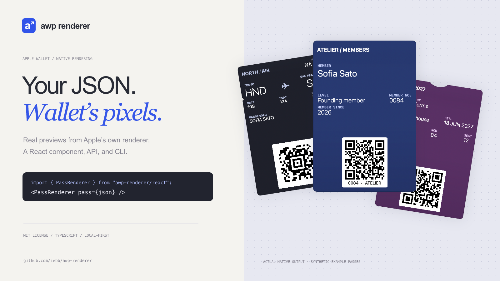
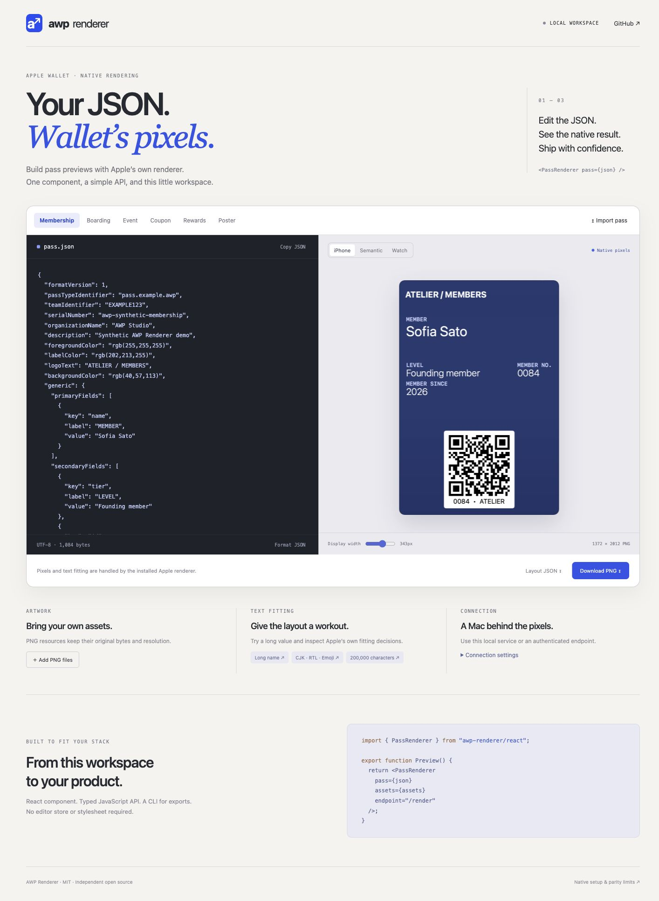
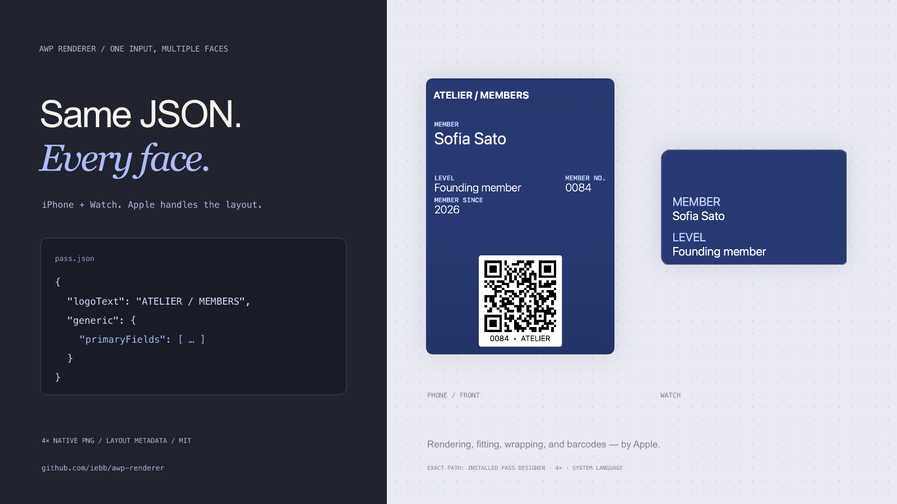

<p align="center"></p>
<h1 align="center">AWP Renderer</h1>
<p align="center">Your JSON. Wallet’s pixels.</p>
<p align="center">A React component, JavaScript API, and Mac CLI for rendering Apple Wallet passes.</p>
<p align="center"><a href="https://github.com/iebb/awp-renderer/actions/workflows/ci.yml"></a> <a href="LICENSE"></a> <a href="https://github.com/iebb/awp-renderer/releases"></a></p>



Turn `pass.json` and PNG assets into native previews, without rebuilding Wallet’s typography in CSS. AWP Renderer asks the **installed, unmodified Pass Designer renderer** for its pixels. React displays the returned PNG; Apple decides wrapping, shrinking, truncation, artwork, and barcode placement.

- **Use it anywhere:** a provider-free React component, typed promise API, and command-line exports.
- **A convenient local tool:** live JSON editing, six fictional examples, artwork uploads, phone/Watch previews, text stress cases, PNG and layout downloads.
- **Lossless inputs:** JSON source strings, unknown options, empty values, multiple barcodes, PNG resolutions, and localization bytes are retained.
- **Exact by default:** approximate rendering requires an explicit opt-in. Display resizing never regenerates the native PNG.
- **Small maintenance boundaries:** core → transport → React; HTTP → native bridge. No Next.js, editor store, or required stylesheet.

**Native requirement:** rendering runs on a configured Mac. The React UI and HTTP client can run elsewhere. The verified integration uses **macOS 27, Xcode 27, and Pass Designer build 28**, at **4× and the System language**. This is an independent project using non-public Apple interfaces; support for other versions must be verified. No Apple binaries, fonts, or template assets ship in this repository.

## Get started

Install the built release package. This project is distributed through GitHub Releases; it is **not yet published to the npm registry**.

```sh
npm install https://github.com/iebb/awp-renderer/releases/download/v0.1.0/awp-renderer-0.1.0.tgz
npx awp-renderer doctor
npx awp-renderer --open
```

The last command starts the local playground and API at `http://127.0.0.1:43877`. Run it on the rendering Mac, after installing and opening Pass Designer once. See [native setup](docs/native-setup.md) if a doctor check fails.

Or clone and run from source:

```sh
git clone https://github.com/iebb/awp-renderer.git
cd awp-renderer
npm ci
npm start -- --open
```

`npm ci` builds the package and playground. Node **22.15+** is required. React 18.2+ and 19 are supported by the React entry point; core and server consumers do not need React.

<details>
<summary>See the local playground</summary>



</details>

## React

```tsx
'use client';

import { PassRenderer } from 'awp-renderer/react';

const pass = {
  formatVersion: 1,
  passTypeIdentifier: 'pass.example.membership',
  teamIdentifier: 'EXAMPLE123',
  serialNumber: 'member-0084',
  organizationName: 'Atelier',
  description: 'Membership',
  logoText: 'ATELIER / MEMBERS',
  backgroundColor: 'rgb(40,57,113)',
  foregroundColor: 'rgb(255,255,255)',
  generic: {
    primaryFields: [{ key: 'name', label: 'MEMBER', value: 'Sofia Sato' }],
  },
};

export function MembershipPreview() {
  return (
    <PassRenderer
      pass={pass}
      assets={{ 'logo@2x.png': '/artwork/logo@2x.png' }}
      endpoint="/render"
      face="front"
      width={343}
    />
  );
}
```

Point `/render` at a same-origin proxy to the Mac service, or configure an allowed origin for local development. A remote service token belongs in your application server. See [HTTP integration](docs/http-api.md) for a proxy example.

The component accepts an object or a raw JSON string. It debounces edits, aborts obsolete requests, rejects invalid JSON, and removes stale output immediately when the input changes. Multiple instances have independent state. `width` controls CSS presentation; canonical output remains at 4×.

```tsx
import { usePassRenderer } from 'awp-renderer/react';

const { status, result, error } = usePassRenderer(
  { pass: jsonString, assets },
  { endpoint: '/render', face: 'watch' },
);
// result.png: original PNG as base64
// result.layout: native view rectangles, text, and available field keys
// result.source: "pass-designer" for the exact path
```

[Full component API and asset conventions →](docs/api.md)

## JavaScript

```ts
import { renderPass, passRenderInputFromArchive } from 'awp-renderer';

const result = await renderPass(
  { pass, assets: { 'logo.png': new Uint8Array(pngBytes) } },
  { endpoint: 'http://127.0.0.1:43877/render', face: 'watch' },
);

// Read an unsigned resource ZIP or signed .pkpass without editor normalization:
const input = await passRenderInputFromArchive(pkpassBytes);
```

Use an absolute endpoint in Node. Browser assets can be URLs, data URLs, `Blob`/`File`, `Uint8Array`, or `ArrayBuffer`. URL assets are fetched by the caller, subject to its CORS policy; the Mac service does not fetch arbitrary resource URLs.

## CLI

```sh
# JSON and neighboring PNG/localization files → PNG
npx awp-renderer render ./examples/membership.json -o member.png

# Resource directory or .pkpass → Watch PNG + native layout metadata
npx awp-renderer render ./my-pass --face watch -o watch.png --layout watch.json
npx awp-renderer render ./ticket.pkpass -o ticket.png

# Render through an existing Mac service
npx awp-renderer render ./pass.json --endpoint http://127.0.0.1:43877/render -o pass.png

# Pipe JSON, use a separate artwork directory, or choose a service port
cat pass.json | npx awp-renderer render - --assets ./artwork -o pass.png
npx awp-renderer serve --port 43878
```

`awp-renderer --help` documents every option. Exported PNGs are previews; the tool does not sign passes or produce an installable Wallet package.



## Native requirements

The exact path hosts Pass Designer’s existing render extension and requests its snapshot API. A separate Mac worker records native geometry. The PNG’s 50-point margin is removed by cropping its stored samples, preserving RGBA values and color metadata without a canvas or image optimizer.

| Path                                         | Source          | Exactness                                                                   |
| -------------------------------------------- | --------------- | --------------------------------------------------------------------------- |
| Installed Pass Designer, 4×, System language | `pass-designer` | Exact path; verified against independent extension snapshots                |
| Explicit locale or scales 1–3                | `passkit`       | Alternative capture; requires `requireExact: false` / `--allow-approximate` |
| Browser without a rendering Mac              | —               | Shows an actionable setup error                                             |

Face selection is `front`, `semantic`, or `watch`. `semantic` uses the phone face; the JSON’s `preferredStyleSchemes` and semantics control its layout. Different macOS/App builds may render differently. This project does not claim universal device or OS pixel parity.

[Setup and troubleshooting](docs/native-setup.md) · [HTTP API](docs/http-api.md) · [Architecture](docs/architecture.md)

## Verification

The extracted package’s fresh native suite compares **24/24 images exactly** with independent snapshots of Pass Designer build 28: six synthetic pass layouts, phone/Watch, and baseline/200,000-character values. Equality includes **every RGBA channel and PNG color metadata**. See the [committed verification report](docs/verification.json) and [verification notes](docs/verification.md) for scope and reproduction.

```sh
npm run build
npm run check          # Types, input/transport/HTTP/CLI tests, clean tarball consumer
python3 -m pip install Pillow
npm run test:png       # Lossless crop + comparator regressions
npm run test:native    # Configured Mac only; independent native comparisons
```

CI runs the portable checks on Linux with Node 22 and 24. Native parity needs a separately configured Mac and is not implied by Linux CI passing. Package smoke tests install the actual tarball in a fresh directory, test the core without React, and exercise React 18 server rendering and server exports.

## Project layout

```text
src/core/      JSON, resources, bounded ZIPs, HTTP client, public types
src/react/     Component, hook, untouched PNG presentation
src/server/    Mac adapter, lossless PNG crop, HTTP server, diagnostics
native/        Objective-C geometry worker and Swift extension host
bin/           Command-line interface
web/           Local playground, built into the release package
examples/      Fictional, original pass JSON
scripts/       Native comparisons, package smoke test, marketing exports
```

[Contributing](CONTRIBUTING.md) · [Security](SECURITY.md) · [Changelog](CHANGELOG.md)

MIT licensed. See [LICENSE](LICENSE) and [NOTICE](NOTICE). Apple Wallet and Pass Designer are Apple trademarks; this project is not affiliated with or endorsed by Apple.
