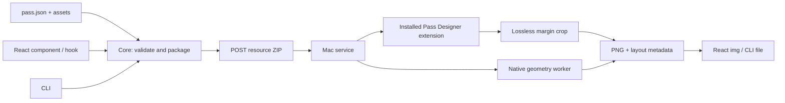

# Architecture

The client never computes pass typography. It validates bounded input and transports exact source/assets. React owns only request lifecycle and accessible presentation. It renders an ordinary image without an optimizer, canvas conversion, external provider, or required CSS.

The Mac adapter compiles project-owned bridge source with Xcode, confines extraction to allowlisted resources, and queues at most two jobs. The official path loads the existing PassRenderSDK and hosts the registered signed extension through AppKit/ExtensionKit. Resources live in a unique disposable directory inside the existing app group so the signed extension can read them. The app is not modified or re-signed.

A separate Catalyst worker instantiates the OS's PKPassView/NPKPassView factories for native geometry and approximate opt-in captures. The exact output comes from the official extension snapshot. Metadata is therefore separate from raster fidelity. A lossless PNG crop retains original stored samples, palette/transparency, and color metadata while removing the app's margin.

Do not merge these boundaries:

- Core: JSON, ZIP, resources, fetch. No React or Node-only imports.
- React: asynchronous state, debounce, cancel, request identity, image markup.
- HTTP: request limits, authentication, origin policy, static playground.
- Native: installed app/framework discovery, compile/launch, extraction, queue, cleanup.
- Playground: example data and UI. Not a dependency of the component.

The public API uses plain serializable metadata and PNG bytes. Future Apple-interface changes should be confined to the native adapter and verified with independent snapshots.
